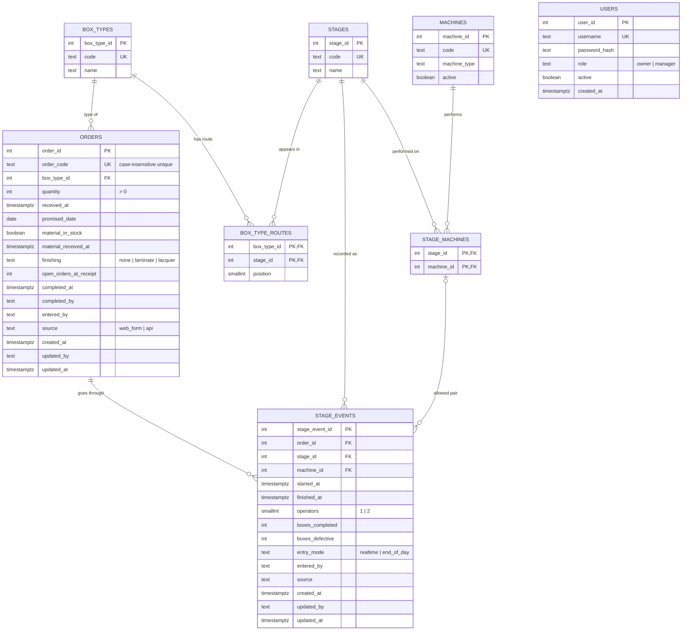

# Database design

PostgreSQL 16. The schema is in [`db/schema.sql`](../../db/schema.sql) and the reference
data (box types, stages, machines, routes) in [`db/reference_data.sql`](../../db/reference_data.sql).

## ER diagram

`entered_by`, `completed_by` and `updated_by` hold the username of the logged-in user who
made the change. They are stored as text, not as a foreign key to `users`, so the record of
who entered data stays intact even if an account is later removed.

## Normalisation

- **Reference data in their own tables.** Box types, stages and machines are stored once
  and referenced by id, so a name changes in one place (they were translated into Uzbek
  without touching any order).
- **Many-to-many relations as junction tables.** Which machine can do which stage
  (`stage_machines`) and which stages each box type goes through (`box_type_routes`) are
  separate tables with composite primary keys, not lists inside a column.
- **No repeated groups or derived duplicates.** Lead time and stage duration are not stored;
  they are calculated from timestamps when needed. The one stored derived value,
  `open_orders_at_receipt`, is a deliberate snapshot of the workload when the order arrived,
  which later data cannot reproduce exactly.

The schema is in third normal form apart from that snapshot.

## Integrity rules enforced by the database

| Rule | How |
|---|---|
| Quantity is positive; counts are not negative | `CHECK (quantity > 0)`, `CHECK (boxes_completed >= 0)` |
| A stage finishes after it starts | `CHECK (finished_at > started_at)` |
| Defects never exceed completed boxes | `CHECK (boxes_defective <= boxes_completed)` |
| An order is completed after it was received | `CHECK (completed_at >= received_at)` |
| Only real machine–stage pairs | composite `FOREIGN KEY (stage_id, machine_id) REFERENCES stage_machines` |
| Each stage once per order | `UNIQUE INDEX (order_id, stage_id)` |
| No duplicate order codes, whatever the letter case | `UNIQUE INDEX (UPPER(order_code))` |
| Fixed vocabularies | `CHECK (role IN (...))`, `CHECK (finishing IN (...))`, `CHECK (entry_mode IN (...))` |

The same rules are also checked in Python (`app/validation.py`) so the user gets a clear
message; the database is the last line of defence.

## Protection against SQL injection

Every query uses psycopg2 **parameters** (`%s` / `%(name)s`); user input is never joined into
SQL text. The only SQL built from strings is a fixed choice from a dictionary written in the
code (for example the status filter in the API or the user-management action), never a value
the user typed.
